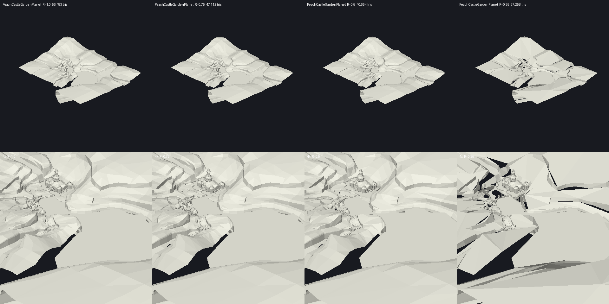
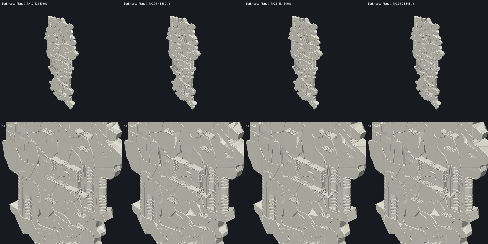
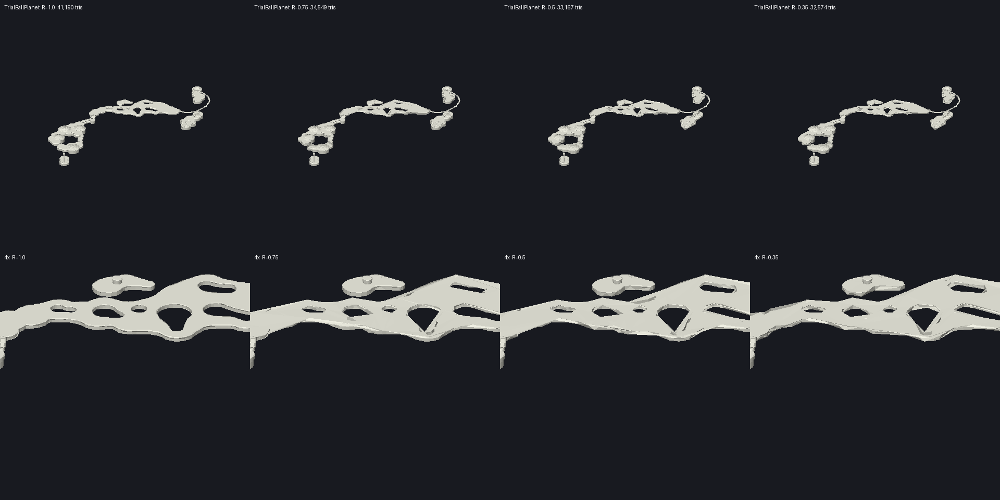
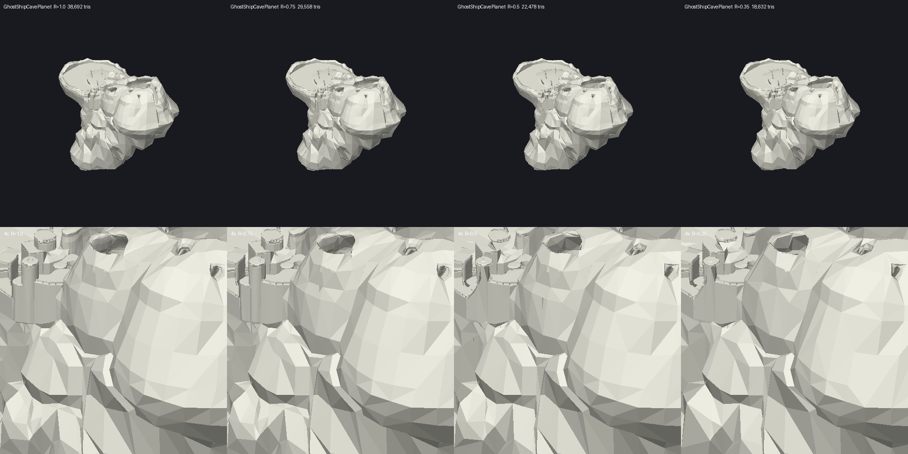

# Phase 0c report (in progress)

## Mesh simplification (tasks 1.1-1.2)

Simplifier: meshoptimizer v1.3 (`bin/meshopt.dll` via ctypes, `tools/simplify.py`). Per J3D matrix group: display-list
primitives -> triangles (`geom.triangles`), positions from VTX1, `meshopt_simplify` to ~R of the triangles, then
`optimizeVertexCacheStrip` + `stripify` with restart markers (free on the GS: XYZ3, ps2tek:1946-1951).

First try used degenerate joins and no cache ordering: 2.1-2.7 emitted vertices per triangle against Nintendo's 1.55,
so R = 0.75 came out **bigger** than the original. With ordering + restarts it is 1.53 per triangle.

GhostShipCavePlanet.bdl (the heaviest planet of the worst scenario), 38 692 triangles, 17 matrix groups:

| R | Emitted vertices | De-indexed MB | `--vu-index=255` MB |
|---|---|---|---|
| 1 (original strips) | 60 073 | 1.15 | 1.00 |
| 0.99 (re-stripped only) | 58 736 | 1.12 | 0.77 |
| 0.75 | 46 666 | 0.89 | 0.64 |
| 0.5 | 36 644 | 0.70 | 0.54 |
| 0.35 | 31 154 | 0.59 | 0.48 |

Re-stripping alone saves 23 % in VU1 mode (better batch locality), before removing any triangle. The simplifier
stops short of its target on meshes with many UV/normal seams: at R = 0.5 it keeps 58 % of the triangles
(`meshopt_SimplifyPermissive` would go further at a texture-quality cost; not used).

## `--simplify=R` in the budget (task 1.3)

`budget.py ... --simplify=R` passes R and the VTX1 positions to `geom.shp1`; the cache key carries R. Check: a run
from an empty cache with `--levers --scenario --vu-index=255 --simplify=1` writes `budget.csv`, `zones.csv` and
`scenarios.csv` byte-identical to `out/vu255` (`cmp`, 39 s).

## Sweep (task 1.4) — `budget.py data/fs/files out/sR --levers --scenario --vu-index=255 --simplify=R`

Per scenario the better of whole and streaming (0b rule). Margin before audio and heap = room − scenario. The audio
column subtracts the 1.88 MB Wii audio solid heap as a **bound** (task 2.4 replaces it); heap is still not counted.

| R | Resident (geo) | Room | Worst scenario | Margin | − 1.88 audio | Negative |
|---|---|---|---|---|---|---|
| 1 (0b, original strips) | 14.44 (3.31) | 9.85 | OceanPhantomCave 1 | +0.76 | −1.12 | 6 / 136 |
| 0.99 (re-stripped only) | 13.95 (2.82) | 10.34 | OceanPhantomCave 1 | +2.13 | +0.25 | 0 / 136 |
| 0.75 | 13.45 (2.32) | 10.84 | OceanPhantomCave 1 | +3.29 | +1.41 | 0 / 136 |
| 0.5 | 12.96 (1.83) | 11.33 | OceanPhantomCave 1 | +4.38 | +2.50 | 0 / 136 |
| 0.35 | 12.70 (1.57) | 11.59 | OceanPhantomCave 1 | +5.02 | +3.14 | 0 / 136 |

Re-stripping alone (R = 0.99, no visible change) is worth 1.37 MB on the worst scenario; each further step of
simplification gives about 1 MB. Whatever R is chosen, the heap now has 1.4-3.1 MB to live in (with the audio bound).
Which R is acceptable is decided by the renders (task 1.5), not by the budget.

## Renders (task 1.5) — `python tools/render.py data/fs/files docs/renders <models>`

Flat-shaded, untextured, painter's algorithm (PIL + numpy); row 1 the whole model, row 2 a 4× zoom on its centre.
Models: the three planets with the most PS2 geometry (PeachCastleGardenPlanet 1.93 MB, DarkHopperPlanetC 1.62,
TrialBallPlanet 1.57, from `out/vu255/cache.json`) plus GhostShipCavePlanet (worst scenario).

Triangles kept (the simplifier stops early on seams): Peach 56 483 → 47 112 / 40 654 / 37 258 at R 0.75 / 0.5 / 0.35;
DarkHopperC 50 610 → 41 860 / 35 164 / 31 843; TrialBall 41 190 → 34 549 / 33 167 / 32 574;
GhostShipCave 38 692 → 29 558 / 22 478 / 18 632.

| Model | R = 0.75 | R = 0.5 | R = 0.35 |
|---|---|---|---|
| GhostShipCave | same | same | same |
| PeachCastleGarden | same | small cracks along pond edges | broken: long slivers, holes |
| DarkHopperC | a few new notches | visible spikes and notches | small detail gone |
| TrialBall | **round holes turn into triangles, curved edges facet** | worse | worse |

**Judgement:** no uniform R below 1 is clean. 0.75 already damages curved, gameplay-relevant shapes (TrialBall is a
rolling-ball course: collision `.kcl` is not simplified, so a visibly triangular hole would not match the round
collision hole). Only re-stripping (R = 0.99, no visible change) is free; it alone gives the worst scenario +2.13 MB
before audio and heap (+0.25 with the 1.88 MB audio bound).

The next step for geometry, if needed after audio and heap, is an **error-capped** simplification (meshoptimizer's
`target_error` instead of a fixed ratio, per model) so flat terrain like GhostShipCave or Peach's slopes shrinks and
curves like TrialBall's are left alone. Not done here.

## SPU2 budget (task 2.1)

| Item | Bytes | Source |
|---|---|---|
| SPU2 RAM | 2 097 152 | ps2tek:111 |
| System areas + MEMIN, halfwords 0x0000-0x27FF | −20 480 | ps2tek:3457-3470 (MEMIN, V); lower part E |
| Reverb, SPACE on one core (largest real reverb; echo/delay are 192 KB but are echoes) | −126 336 | libsd effect.c:27 |
| Music | 0 | ADMA: PCM straight into MEMIN, no sample RAM (ps2tek:3453) |
| **Sample budget for curated waves** | **1 950 336 (1.86 MB)** | |

Design choices behind it (D): reverb on one core only (the other core plays dry voices and ADMA); music through ADMA,
two stereo pairs over the two cores = the 4 stream channels SMG uses (`AudParams.cpp` `numStreamChannels = 4`). ADMA
runs at the SPU2 output rate, so `.ast` streams (32 kHz on the Wii, `AudParams.cpp` `streamSampleRate`) are resampled
offline; their buffers live in IOP or EE RAM (task 2.4), not in SPU2. With reverb HALL instead of SPACE the budget is
1.89 MB; with no reverb 1.98 MB.

## Which waves a scene can play (task 2.2) — `tools/audio.py` `waves()` / `referenced()`

Static chain from the game's tables: scene → loaded wave banks (`AudSceneMgr`) → instrument banks bound to them
(`bnk ` commands) → instruments and percussion → wave ids → archive and size (WSYS ctrl table).

Result: **every one of the 1 796 waves is referenced by some instrument or percussion region** (22.95 MB as SPU ADPCM,
all referenced; cross-check: 0 referenced ids missing from their bank). Bank 34 (player voices) has 320 waves in 3
archives sharing 160 ids. So the tables cut nothing: by them a scene can play every wave of its loaded banks, the
12.06–13.09 MB of 0b.

What the tables cannot say is which instruments are actually played. Two ways to learn it:

1. **Music vs effects split** (static): disassemble the BMS sequences (BGM in `AudioRes/Seqs/JaiSeq.arc`, effects in
   the BSC collection) following jumps, and collect the banks each one selects (`cmdBank` / `cmdBankPrg`). A bank used
   only by sequenced music leaves SPU2 if that music is pre-rendered to an ADMA stream. Bank 2 (4.65 MB, always
   loaded) is the one to check first.
2. **Observed use** (Dolphin): log the waves started per scene while playing. Exact, needs play time.

## Music vs effects (task 2.2b) — `tools/bms.py` + `audio.py` `sequences()` / `reached()`

`bms.analyse` follows each sequence's flow (jumps, calls, child tracks, both sides of conditionals) carrying the
current bank and program, and records the (bank, program) of every note. Programs resolve to waves through
`instruments()` (IBNK number = word 2). 105 BGM sequences, 3 245 SE sequences; 50 BGM and 63 SE paths ran off their
data (counted as `bad`, path dropped), 2 jump tables not followed.

| | Notes with a bank | Notes with no static bank | Waves reached | PS2 MB |
|---|---|---|---|---|
| BGM (sequenced music) | mostly IBNK 0, 1, 8, 9 → wave banks 0, 1, 10, 23 | 15 798 | 194 | 3.05 |
| SE (effects) | IBNK 64, 72, 74, 65, … (64 → wave bank 2 is the top user) | 19 583 | 1 349 | 18.35 |
| Music only (not reached by any SE) | | | 100 | **1.73** |

The music banks match the names (`B00mahit`/`B01mahit` = the composer's banks) and the BGM wave sets in
`AudSceneMgr` (`cBgmWaveSet` = 10, 23). Bank 2 (`B64kawa`, 4.65 MB, always loaded) is **effects**, not music. Some BGM
notes name banks 2-7 and 10-19, which have no IBNK; they resolve no wave.

Pre-rendering all sequenced music to ADMA streams and dropping the music-only waves:

| Max sample rate | Always loaded | Worst scene (KoopaBattleVs3 0) |
|---|---|---|
| original | 10.48 MB | 11.50 MB |
| 16 kHz | 7.75 | 8.74 |
| 11 025 Hz | 5.46 | 6.15 |
| 8 kHz | 4.00 | 4.50 |

Against the 1.86 MB SPU2 budget, **the effects alone are 2.4× over even at 8 kHz** (6× at the original rate). The
game's data cannot say which effects a scene really uses (19 583 SE notes take their bank from outside the sequence,
and actors pick sounds in code). Task 2.3 therefore needs either per-scene use observed in Dolphin, or a cut list
decided by hand.

### Correction to 2.2b (decoder bug)

`cmdWait` (0xF0) reads a MIDI varint inside its handler, and `cmdPrintf` (0xFD) a string; the first version of
`bms.py` skipped neither, so the byte after every wait was decoded as a note. With both fixed (selftest: "wait 1 is
not a note"), and notes resolved per key region instead of whole programs: 0 paths run off their data (was 113), and
only 23 SE sequences (17 remix notes, 6 HOME menu) leave their bank unset (was 2 967). Corrected split:

| | Waves | PS2 MB |
|---|---|---|
| BGM sequences reach | 168 | 2.69 |
| SE sequences reach | 1 336 | 18.14 |
| Music only | 134 | 2.09 |
| Played by no sequence (unused key regions) | 166 | 1.50 |

## Hand-cut effects set (task 2.3) — `python tools/sfxcut.py data/fs/files out/s099/scenario_sets.json`

Per scenario, the effects kept are (`tools/sfxcut.py`, all rules D):

1. **Mario everywhere**: PLAYER_VOICE, PLAYER_MOTION and REMIX_SEQ whole.
2. **Global code**: SE names written in `Game/{Player,Screen,System,Scene,Camera,Util,AudioLib,Demo,LiveActor,Effect,
   Gravity,NameObj,Speaker,RhythmLib}` (182 names). SYSTEM sounds count only through code, like the rest.
3. **Placed only**: SE names in the `.cpp` of the classes the scenario's placed objects create (NameObjFactory
   template argument), plus every class those files `new`, transitively; StageEffectDataTable entries for placed
   names; sounds named by the `.bas` animation tables in the archives the scenario loads.
4. **Dropped**: HOME_BUTTON_MENU (Wii only), DEMO (cutscene sounds ride in the cutscene's pre-rendered stream), music
   (pre-rendered to ADMA streams), and every sound none of the above names.
5. **Resampled**: player and system to ≤ 8 kHz, everything else to ≤ 6 kHz; a wave shared by several kept sounds
   keeps the highest cap. A note whose key is read from a register (random voice variant) keeps one variant.

Cut list: `docs/sfx-cut.csv`, one row per SE name: 1 695 kept where their class is placed, 267 kept everywhere
(whole category), 151 kept through global code, 1 083 dropped with no known user, 49 dropped by category.

How each rule moved the worst scenario (SPU ADPCM):

| Step | Worst scenario | MB | Over the 1.86 MB budget |
|---|---|---|---|
| All loaded banks (0b) | KoopaBattleVs3 0 | 13.09 | 136 / 136 |
| Placed/global/category filter, original rates | PhantomGalaxy 3 | 6.64 | 136 |
| + rates: player/system 11 kHz, rest 8 kHz | PhantomGalaxy 3 | 2.93 | 136 |
| + one variant per random voice + player 8 kHz | EggStar 3 | 2.30 | 63 |
| + rest at 6 kHz (**chosen**) | EggStar 3 | **1.91** | **1** |

EggStar 3 is 0.05 MB over with reverb SPACE; with reverb ROOM (19 KB instead of 123 KB, libsd effect.c:27) the
budget is 2.06 MB and all 136 fit. Median scenario 1.57 MB.

**Cost, said plainly:** 6 kHz keeps only content under 3 kHz: objects, enemies and ambience will sound muffled; Mario
and the UI at 8 kHz (under 4 kHz) lose their brightness. Random voice variants collapse to one. Risks of the static
filter: a sound played by a helper class reached other than by `new` (templates, function tables), or named by a
string built at run time, is dropped and would be silent; the 17 remix-note sounds take their instrument from the
current music, which is pre-rendered, so they need their own small sample set. Upgrade path for both: log the SE ids
played per scenario in Dolphin and add what is missing.
