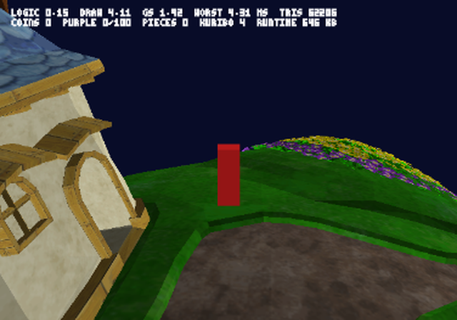
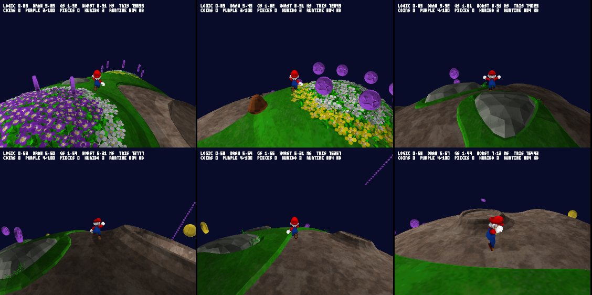
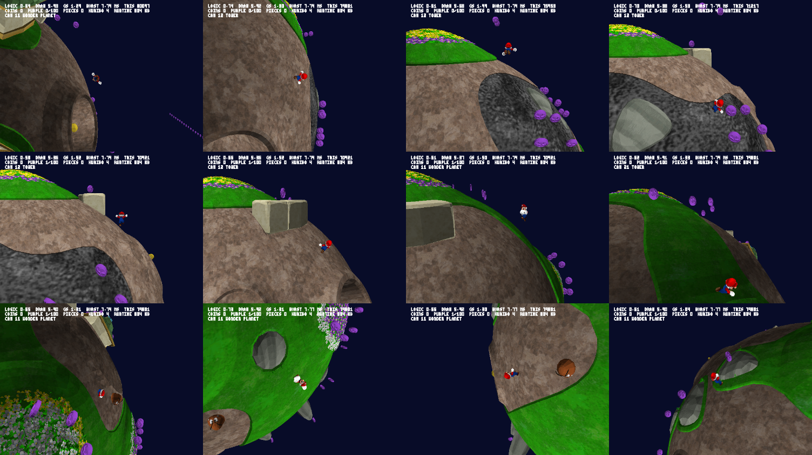

# Phase 2 report — full engine

## Milestone 1: resident budget

### 1.1 What the Wii keeps resident (Gateway 2 dump, `tools/stationed.py`)

The resident heaps are the two stationed heaps (6.69 MB MEM1 + 19.30 MB MEM2, full). `game_mem1/2` only hold the file
cache and the scene heaps (nested), so nothing else is resident besides WPAD (0.08 MB) and the HOME button heap (0.15).
The phase 0c dumps were not kept; the Gateway 2 dump (`tools/dolphin/dumps/hd2`, phase 1) has the same stationed
heaps (same sizes, both full).

`tools/stationed.py` walks every 'HM' block of the stationed heaps (child heaps opened, 25.99 of 25.99 MB classified):
- C++ objects by vtable. main.dol is RMGE01 and Petari's symbols are RMGK01; the two builds differ by small shifting
  offsets, so the 5 676 US vtables are aligned with the 5 594 KR `__vt__` symbols as sequences of vtable sizes
  (5 507 matched, neighbouring names consistent). Class → Petari source dir through `splits.txt`, or a prefix rule
  (J3D/JPA/JKR/JAS…).
- Archives by magic (RARC/Yaz0/U8), stacks by the 0xDEADBABE fill, video buffers by size, all-zero blocks.
- Anything else is charged to the closest preceding object in the same heap (exp heaps hand out memory in order).

| System (Wii) | MB | What it is |
|---|---|---|
| Archives | 18.15 | 231 mounted archives (MarioAnime 2.82, Effect 2.47 …) |
| Video | 3.04 | XFB ×3 (2.08), screen capture BTI RGB565 640×456 (0.58), GX FIFO (0.50) |
| Particles | 1.65 | JPA resource tree (field objects + their resource data, 1.52) and EffectSystem (0.13) |
| J3D model instances | 1.09 | materials/TEV/PE blocks, shapes, anim keys of resident models |
| Archive directories | 0.87 | JKRArchive + data (0.31), JUTNameTab + data (0.56) |
| Layouts / HUD | 0.54 | LayoutHolder, CustomTagProcessor, nw4r::lyt panes, ResFont, LayoutAnmPlayer |
| Stacks | 0.25 | 6 thread stacks |
| Zero (reserved, not written) | 0.22 | 281 blocks |
| Game system | 0.14 | GameDataPlayerStatus (0.07), FileLoaderThread (0.05), rumble, NAND, scenario parser |
| Wii-only services | 0.04 | NWC24 messenger, JUTConsole, WPadRumble |
| Unclassified | 0.02 | |
| Plus WPAD + HOME button heaps | 0.23 | |

Sound is not here: it lives in its own 1.87 MB heap, already budgeted (0.68 MB EE, phase 0c). Camera, player and
object managers are created per scene, so they are in the scene runtime phase 1 extrapolated (1.52 MB).

Archives against the asset budget: 184 of the 190 StationedFileInfo entries are in memory (the missing ones are HOME
button, config and SpeakerSe); 54 archives (0.97 MB) are outside the list by name, almost all because of how they
mount (`message.arc` has the root `usenglish`, the HOME menu is U8) plus ~40 KB of `*GalaxyScenario` data and one
131 KB Yaz0 block. So the 13.95 MB resident asset row (R = 0.99) stays the reference for the archives.

### 1.2 PS2 decision per system

Budgets are PS2 bytes in the engine's arena (`mem_report` type), checked at each later gate.

| System | Wii MB | PS2 | Budget MB | Reason |
|---|---|---|---|---|
| Archives | 18.15 | replaced (converted) | 0 | already in the resident asset row (13.95 MB) |
| Video | 3.04 | replaced (GS VRAM) | 0 | frames live in the GS; packet buffers already in phase 1's render row; this room is already in the 6.35 MB |
| Particles | 1.65 | needed | 0.40 | the converter writes particle definitions read in place; budget for the emitter table, index and per-type state |
| J3D model instances | 1.09 | replaced | 0.10 | VUMD batches read in place (phase 1); budget for the joint matrices and anim state of resident models |
| Archive directories | 0.87 | replaced | 0.02 | the blob's chunk index (read in place) |
| Layouts / HUD | 0.54 | needed | 0.25 | own 2D HUD on sprites (phase 1 font): glyph table, layout instances, text of the current screen |
| Stacks | 0.25 | needed | 0.16 | main, loader and pad/memory-card threads |
| Game system (save, loader, scenario) | 0.14 | needed | 0.10 | GameData as on the Wii (0.07) and the loader's buffers |
| Zero (reserved) | 0.22 | dropped | 0 | never written |
| Wii-only services, WPAD, HOME | 0.27 | dropped | 0 | NWC24, Wii remote, HOME menu; the pad and memory card run as IOP modules |
| Unclassified | 0.02 | — | 0.02 | kept as slack |
| **Total** | **25.99 + 0.23** | | **1.05** | |

Risk carried forward: the particle budget assumes the converted Effect.arc read in place is no bigger than the Wii
archive (counted in the asset row). Milestone 2 or later checks it when particles are converted.

### 1.3 Gate

| Row | Value | Budget |
|---|---|---|
| Resident systems (1.2) | 1.05 MB | 4.83 MB (6.35 room − 1.52 scene runtime) |
| Worst frame | no engine change in this milestone (phase 1: 5.51 ms, ×2.80 = 15.4 ms) | 16.7 ms |

**Verdict: GO**, 3.78 MB left. Most of the Wii's resident runtime is either GPU/video (3.04) or structures derived from
archives (J3D instances, particle trees, archive directories: 3.61) that a read-in-place blob does not build. The
budgets in 1.2 are targets; each later gate checks them with `mem_report`.

## Milestone 2: textures

### 2.1 Converter (`tools/tex.py`, `tools/slice.py`, blob v3)

- GX decoding of I4, I8, IA4, IA8, RGB565, RGB5A3, RGBA8 and CMPR (palette formats raise; none in Gateway 2), checked
  against a before/after sheet of the 26 textures of the slice's models.
- **PS2 rule** (same bytes as phase 0's lever): a GX mirror axis is doubled with a mirrored copy and its UVs halved
  (the GS has no mirror mode); each axis halved (box filter) down to 128; 16 colours (Pillow FASTOCTREE, alpha kept) as
  PSMT4 + a 16-entry PSMCT32 CLUT, alpha scaled to 0..0x80; no mip levels. Alpha kind from the texture: opaque,
  cut-out (only 0/255) or blended.
- Material per shape from the INF1 hierarchy; per material the first TEV stage that samples a texture gives the TEX1
  index, the coordinate source and the texture matrix (plain SRT applied per vertex, `J3DGetTextureMtx` /
  `J3DGetTextureMtxMaya`; projected types would keep raw coordinates: none in Gateway).
- VUMD v3 per vertex: position f32×4 (16 B), colour u8×4 (4 B), UV s16×2 with 12 fraction bits (4 B), each array
  padded to 16; a triangle's UVs are shifted by whole repeats towards 0. 24 B per vertex instead of 32.

| Blob (Gateway 2, R = 0.99) | Phase 1 | Milestone 2 |
|---|---|---|
| VUMD | 3.96 MB | 2.96 MB |
| TEXT (18 textures after dedup, pixels + CLUTs) | — | 141 008 B |
| Total | 5.05 MB | 4.24 MB |

UVs clamped: 0. Groups without texture: 3 (Coin, PurpleCoin, StarPiece: their only texture is generated from normals,
an environment map; they keep their flat colour). Kuribo's face animation (5 eye textures) shows the first one.

### 2.2 Engine

- Textures go to VRAM **once at load**: two 640×448 32-bit frames and Z24 leave ~736 KB, Gateway's set takes 144 KB
  (texture rows 128 pixels wide, PSMT4 needs an even buffer width). This replaces design decision 3 (per-frame upload
  over PATH3) while a scene's set fits; streaming comes back at milestone 5 if a galaxy does not fit.
- A texture change is a REF to a prebuilt A+D packet (TEX0 with CLUT load, TEX1 bilinear, CLAMP, TEST with alpha test
  for cut-outs) behind FLUSH + DIRECT in the VIF chain.
- `vu1_tex.vsm` replaces the flat microprogram: STQ (perspective-correct), colour and position per vertex; untextured
  batches use the same code with TME = 0. Colours unpack as V4-8 and UVs as V2-16 straight from the blob; batches of
  72 vertices (6n + 3 qwords in a 496-qword buffer, a multiple of 12 so the 4-byte arrays stay qword-aligned).

### 2.3 Gate (PCSX2, `build.sh bench`, the phase 1 path)

| Row | Value | Budget |
|---|---|---|
| Texture RAM (TEXT chunk, in the blob) | 141 008 B | part of the resident asset row (phase 0 lever: 128 px, 4 bpp) |
| VRAM | frames + Z 3.28 MB, textures + CLUTs 144 KB, ~590 KB free | 4 MB |
| Runtime (`mem_report`) | 662 160 B (render 659 376: +1 968 for texture packets and the second header table) | resident budget row "render" unchanged |
| Worst frame | 6.96 ms (logic 0.05, KCL 0.22, draw 4.63, GS finish 2.21 worst; average 6.50) | 16.7 ms |

Same end position as phase 1 (Mario −510, 290, −1982; 4 purple coins, 2 Kuribo), up to 70 720 triangles in view.
Video: `videos/2026-10-07_0923_phase2-textures_5d4b998.mp4` (PCSX2's capture slows the emulator to ~28 fps on the
host, so the bench numbers come from a second run without capture; they are emulated EE cycles either way).

**Verdict: GO** (6.96 of 16.7 ms on Gateway 2; VRAM and RAM within budget).

Flagged for milestone 5: the EE draw time went from 2.2 to 4.3-4.6 ms (1.7× more batches and two more unpacks per
batch). With phase 1's ×2.80 object rule the extrapolated OceanPhantomCave 1 frame is now 19.5 ms, over 16.7. The EE
rebuilds every model's chain each frame; prebuilt per-model chains (CALL with only the matrix changing) and larger
batches are the fix to try before the heavy-scenario gate.

## Milestone 3: Mario

### 3.1 Converter (`tools/skin.py`, `tools/slice.py`)

- `mario.bdl`: 30 joints, 48 draw matrices (22 rigid, 26 weighted over 13 envelopes), 9 shapes (8 single-matrix,
  1 with 4 groups of 10). Rigid vertices are in their joint's space, weighted ones in model space (J3D uses the joint
  matrix as is for rigid entries, `sum(w * world * invbind)` for envelopes); checked by composing the bind pose and
  six clips offline (`docs/renders/phase2-mario-poses.png`). Converted unsimplified (one group mixes joint spaces).
- VUMD per vertex: the matrix slot (PNMTXIDX / 3) rides in the low 16 bits of position w (static models keep
  1.0f, whose low bits read as slot 0), colour from CLR0. Material texture: of the TEV stages that sample a texture,
  the largest one (Mario's first stage samples a 64×64 noise texture; the colour map comes later). This also gave
  PurpleCoin and Kuribo their colour maps in Gateway.
- `SKIN` chunk (4 608 B): bind pose, draw entries and envelope mixes with inverse binds, the matrix table of each
  VUMD group.
- `ANIM` chunk: all 456 BCK clips of MarioAnime.arc, converted to little-endian (same key tables) and zlib-9
  compressed one by one: 1 558 096 B (raw BCK 2 601 600 B).

### 3.2 Engine

- `vu1_tex.vsm`: every batch carries its matrices (1 for static models, up to 10 for a skinned group) in the double
  buffer, and each vertex picks one by its slot (`mtir`); 3 + 4m + 6n qwords, n = 72. This also removes the old
  single matrix at VU address 0, which the VIF could overwrite while the previous model's batch was still running.
- `anim.c`: clips inflated with zlib (ps2dev's `libz.a`) into 4 cache slots on play; keys evaluated as
  J3DGetKeyFrameInterpolation / JMAHermiteInterpolation (both key layouts, constant and default tracks, rotation
  `<< dec_shift`); joint world matrices, then draw matrices (rigid or envelope sums). The renderer premultiplies them by
  projection × view × world per group.

### 3.3 Player (Petari `MarioJump.cpp`, `MarioConst.cpp` gMarioConstDefault)

Ported on the phase 1 physics (gravity per point/plane, KCL sphere):

| Move | Rule and constants |
|---|---|
| Walk / run | `mWalkSpeed` 13, `mInertiaStandardMax` 0.9 (stick held), `mInertiaStandardStop` 0.94; wait / walk / run clips by speed ratio |
| Jump, 2nd, 3rd | `tryJump`: next kind if it starts within `mJumpConnectTime` 7 frames of landing; the 3rd needs ratio ≥ `mJumpConnectSpeed` 0.6; front `ratio × mJumpFrontSpeed` 12.5, up `mJumpHeight` 22 / 26 / 36, gravity `mGravityJumping`; clips Jump / Jump2 / JumpRoll and their landings (Petari's animation table) |
| Long jump | `trySquatJump` (squat + jump with ratio > 0.3): front `mSquatJumpFrontSpeed` 16.5, up 15, gravity 0.95, front reduction 0.99 after 30 frames; JumpBroad |
| Back flip | `tryBackJump` (squat + jump standing): back `mSquatJumpBackSpeed` 5, up 32; JumpBack |
| Spin | `trySpinJump` once per jump: up `mSpinJumpHeight` 12, front `ratio × mJumpTornadoSpeed` 5, gravity 0.4 for `mAirWalkTimeSpin` 24 frames; on the ground SpinGround for `mStartSpinTime` 30 |
| Wall | touching a wall in the air: WallSlide while falling, jump = wall kick (`mWallJumpPowerXZ` 13 away from the wall, `mWallJumpPowerY` 30) |
| Slopes | floors steeper than `mSlipAngle` 60° are not ground (Mario slides off); on ground the velocity follows the floor plane |
| Squat | R1 (the Wii's Z): `mInertiaSquat` 0.95, `mSquatWalkMaxSpeed` 0.2 |

Bench path for this milestone (`pad.c`): forward with X every 4 frames for 85 of every 180 frames (jump chains),
a right-hand circle with a spin every 2 s and a long jump every 2 s, then forward-left with a jump every 1.5 s and a
back flip every 3 s. The bench build logs every take-off: the run produced Jump → Jump2 → JumpRoll three times, spin,
8 long jumps and 2 back flips.

Not ported (list for later milestones): hip drop and homing hip drop, turn jump (side somersault), brake/turn slip,
belly and hip slides on slip floors, wall grip / wall walk, ledge hang and climb, swimming, poles, trees and ropes,
power-ups (Bee, Boo, Fire, Ice, Spring, Rainbow, Flying), damage and knock-back clips, Petari's air-walk timers
(replaced by one air-steering factor), blending between locomotion clips (Petari blends WalkSoft / Walk / Run / Wait),
upper-body layers and the eye/face texture animations (BTP).

### 3.4 Gate (PCSX2, `build.sh bench`, this milestone's path)

| Row | Value | Budget |
|---|---|---|
| Player runtime (`mem_report` "player") | 147 280 B: clip cache 4 × 33 232 B = 132 928, clip table 7 KB, Anim (world + draw matrices) 6 KB, SKIN headers | Wii player 297 KB (phase 1) |
| Animation bytes in RAM | 1 558 096 B compressed (blob) + 132 928 cache = 1.61 MB | resident asset row counted MarioAnime at 1.50 MB (phase 0 lever): +0.11 MB, inside milestone 1's 3.78 MB left |
| Mario model (blob) | VUMD ~0.35 MB, SKIN 4.6 KB | asset row |
| Render runtime | 674 816 B (+15 KB: header tables for 1-10 matrices) | |
| Worst frame | 9.16 ms (logic 1.73, KCL 0.39, draw 5.88, GS finish 2.19 worst; average 7.67) | 16.7 ms |

The logic worst (1.73 ms) is a clip inflate on a clip change; the average logic is 0.52 ms (pose + 48 draw
matrices). The cache slot is sized by the largest clip (a 33 KB demo clip; the median clip is 4.6 KB): capping
gameplay slots and inflating demo clips on their own would cut ~100 KB when memory gets tight.

Video: `videos/2026-10-07_0953_phase2-mario_429eb06.mp4`.

**Verdict: GO** (9.16 of 16.7 ms on Gateway 2; player and animation memory within the margins above). The EE draw
time flagged at milestone 2 is now 5.9 ms worst (more batches: one matrix REF per batch); the prebuilt-chain work
stays the first item before the heavy-scenario gate.

## Milestone 4: camera

### 4.1 Data (`tools/camera.py`, blob chunks CAMS and CARE)

- Camera areas from `jmp/placement/<layer>/cameracubeinfo`: CubeCameraBox (centre-origin cube, 1000 × scale),
  CubeCameraCylinder (base origin, radius 500 × scale_x, height 500 × scale_y), CubeCameraSphere (radius
  500 × scale_x) (AreaForm.cpp). Obj_arg0 is the camera `c:%04x` of the same zone; areas are selection-sorted on
  Obj_arg2 exactly as CubeCameraMgr::sort and the last one containing Mario wins (AreaObjMgr::find_in). Areas whose
  category mask (Obj_arg3) lacks the normal-game bit, or that start invalid, are dropped.
- Cameras from each stage's `camera/cameraparam.bcam` (JMap; field names from CameraParamChunk::load, vectors as
  `.X/.Y/.Z`), game cameras only (`c:`, `s:`, `o:`), missing fields filled with CameraParamChunk's defaults.
- Gateway 2: 28 cameras (CAMS 3 600 B) and 9 areas (CARE 384 B): a sphere around the whole planet
  (WONDER_PLANET, distance 1600, minimum pitch 0.7 rad), two tower cylinders and a box (TOWER), cylinders on the
  slopes (WONDER_PLANET 0x14 / 0x15) and the parallel cameras 2 and 0x17 (XZ_PARA).

### 4.2 Engine (`camera.c`)

Formulas extracted from Petari (CameraParallel, CameraTower, CameraWonderPlanet, CameraFollow, CameraFixedPoint,
CameraLocalUtil::makeWatchPoint, CameraHeightArrange, CameraViewInterpolator, CameraManGame):

| Type | Ported |
|---|---|
| XZ_PARA | watch + polar(dist ≥ 300, angleB, angleA − 90°), zone up |
| TOWER | ideal = watch + (horizontal direction from the tower axis lifted by angleB) × dist; the yaw lags the ideal one by up to π(1 − angleA)/2; horizontal length eased 0.05 |
| WONDER_PLANET | dragged along in Mario's frame: pitch eased (0.05) up to angleA, distance clamped to axis.x .. axis.y, camera up turned with the view direction |
| FOLLOW | distance clamp (axis.y .. axis.x with the 0.5 overshoot rule), pitch window angleA .. angleA + angleB, yaw converging behind Mario at `dist` degrees/frame scaled by speed, none while jumping |
| EYEPOS_FIX | eye at wpoint, looking at the watch point |

Watch point: Mario + woffset (zone frame) + an eased loffset / loffsetv in Mario's frame. Vertical pan: the watch
height along vpanaxis is frozen while Mario is in the air and eased at 0.05 otherwise. Switching cameras: the new
camera starts from the current pose and blends over its camint frames with r = (t / camint)²; then the final
pose is smoothed at 0.3 per frame (0.1 for fovy). The renderer now takes the camera's fovy (45° default).
Without an area the current camera is kept, and the CameraHolder default (XZ_PARA, distance 1200) is used before
the first area. Host test `engine/test/test_camera.c` covers the three area shapes and the "last area wins" rule.

Not ported:
- **Camera types** (they run as XZ_PARA, as Petari does for unknown names):
  - in Gateway, MEDIAN_PLANET (no area uses it), FOO_FIGHTER_PLANET (its area is for the Star Ball mode only), and WATER_PLANET / POINT_FIX (event cameras);
  - in Good Egg, CHARMED_FIX (8 areas), TOWER_POS (4), EYEPOS_FIX_THERE, MEDIAN_PLANET, OBJ_PARALLEL, TRUNDLE, FRONT_AND_BACK and TRIPOD_PLANET.
  - The five ported types cover 78 of Good Egg's 99 area cameras.
- **Camera sources:** ground-triangle cameras (`g:`, read from the collision attribute table), start cameras (`s:`) and event cameras (`e:`).
- **Behaviour:**
  - C-stick rounding and reset;
  - the upper / lower screen pushes of the vertical pan (one clamp at uplay instead);
  - FOLLOW's wall and height arrangement;
  - `gflag.thru` / `camendint`;
  - the rotation slerp of the interpolator (positions are blended instead).

### 4.3 Gate (PCSX2, `build.sh bench`, milestone 3's input path)

| Row | Value | Budget |
|---|---|---|
| Camera data (blob) | CAMS 3 600 B + CARE 384 B | asset row |
| Camera runtime | 324 B static state (`camera.o` bss), no arena use | |
| Worst frame | 9.09 ms (logic 1.76, KCL 0.27, draw 5.95, GS finish 1.59 worst; average 7.84) | 16.7 ms |

The input path is milestone 3's, but the stick is camera-relative, so with SMG's cameras Mario walks elsewhere
(end position 1295, 1640, 69). Video: `videos/2026-10-07_1015_phase2-camera_543f2c2.mp4`.

**Verdict: GO** (9.09 of 16.7 ms; camera bytes negligible).
